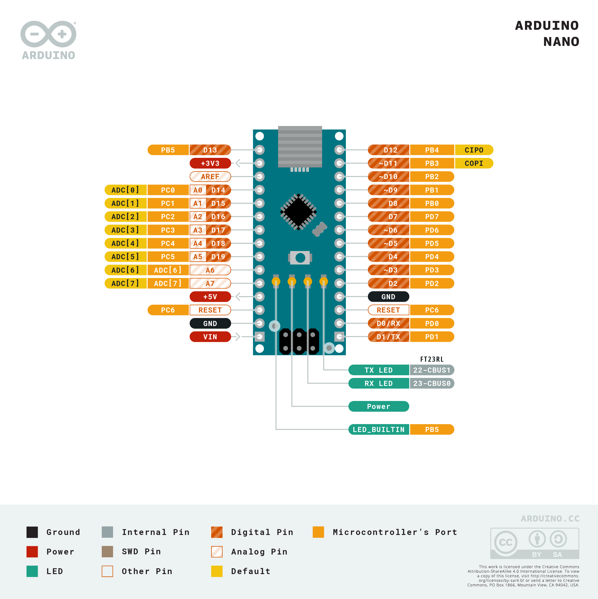

# Arduino Nano

The Arduino Nano is a small, breadboard friendly board with the same
microcontroller as the Arduino Uno: the **ATmega328P** (8-bit AVR,
16 MHz) with 32 KB Flash, 2 KB SRAM and 1 KB EEPROM. The USB connection
(Mini-B) is handled by an **FT232RL** USB to serial converter. Many
clones use the cheaper **CH340** instead.

Compared with the Uno, the Nano offers two additional analog inputs
(**A6 and A7**) but no barrel jack and no IOREF pin.

* [Datasheet](datasheet-nano.pdf)


## Pinout



### Power Pins

* **VIN**: Unregulated input voltage, 7V to 12V recommended (limits 6V
    to 20V). The onboard regulator converts it to 5V.
* **5V**: Regulated 5V output from the onboard regulator or the USB
    port. You can also supply a regulated 5V here, which bypasses the
    regulator.
* **3V3**: 3.3V output. On the original Nano it comes from the FT232RL,
    so only a few mA (max. 50 mA) are available. On clones with a CH340,
    it can be even less.
* **GND**: Power/data/signal ground (two pins).
* **AREF**: External reference voltage for the ADC, used with
    `analogReference(EXTERNAL)`. Never apply more than 5V.
* **RESET**: Pull it `LOW` to reset the microcontroller (two pins).

The I/O pins work with **5V logic**. A single pin can deliver 20 mA
(40 mA absolute maximum), and the whole chip should not exceed 200 mA.


### Digital IO

The pins **D0 to D13** and **A0 to A5** (= D14 to D19) can be used as
digital GPIO. As on the Uno, there are **no strapping pins**: after a
reset, all pins are inputs (high impedance) until the sketch configures
them.

A few pins are *special* and are best avoided (or used with care):

* **A6 and A7** Analog Input Only:
    On the ATmega328P in the TQFP package, ADC6 and ADC7 are connected
    only to the ADC, not to a port. They can **only be used with
    `analogRead()`**. `pinMode()`, `digitalRead()` and `digitalWrite()`
    do not work on these pins, and there is no internal pullup resistor.

* **D0 / RX and D1 / TX** Serial and Upload:
    These pins are connected to the USB to serial converter via 1 kOhm
    resistors. They are used by `Serial` and for uploading new
    firmware. Hardware connected to D0 can block the upload.

    If you must use them: disconnect your circuit while uploading, and do
    not use `Serial` at the same time.

* **D13** LED_BUILTIN:
    On the Nano, the onboard LED is connected **directly** (with a
    resistor) to D13. Used as an output, this is no problem. Used as an
    input, the LED and its resistor pull the pin towards `LOW`, so
    `INPUT_PULLUP` does not work reliably on D13. The bootloader also
    flashes the LED after every reset.

* **D10 to D13** SPI:
    These pins are used by the SPI interface and are also available on
    the ICSP header. **D10 (SS)** must be configured as `OUTPUT` when the
    ATmega328P is an SPI controller.

* **RESET** and Auto Reset:
    Opening the serial port resets the ATmega328P (via the DTR signal of
    the USB to serial converter). This **restarts the sketch** each time
    the serial monitor is opened.

Special functions on the digital pins:

* **PWM** (`analogWrite()`): D3, D5, D6, D9, D10, D11 (marked with `~`)
* **External interrupts** (`attachInterrupt()`): D2 (INT0), D3 (INT1)
* **Pin change interrupts**: all digital pins and A0 to A5

Practical rule of thumb:

* **Best default GPIO choices**: Use **D2 to D9** for general purpose
    I/O. Use D2 and D3 for buttons or sensors that need an interrupt, and
    the PWM pins for LEDs, servos or motor drivers.

* **If you need every pin**: D10 to D12 and A0 to A5 are normal GPIOs as
    long as SPI and I2C are not used. Use A6 and A7 for analog sensors
    like potentiometers. Avoid D0 and D1 unless the sketch does not use
    `Serial`, and do not use D13 as an input with pullup.


## Analog Inputs

The pins **A0 to A7** are connected to the 10-bit ADC (`analogRead()`
returns 0 to 1023). With the default reference of 5V, the resolution
is about 4.9 mV.

```C++
int value = analogRead(A7);                 // 0 to 1023
float voltage = value * 5.0 / 1023.0;       // 0V to 5V
```


## I2C

The I2C pins are fixed by the hardware:

* **A4 (D18, PC4)**: SDA

* **A5 (D19, PC5)**: SCL

The ATmega328P cannot route I2C to other pins, so `Wire.begin()` has no
pin parameters.

_Example:_ Arduino using I2C

```C++
#include <Wire.h>

void setup()
{
    Wire.begin();   // SDA = A4, SCL = A5
}
```


## UART

The Nano has only **one hardware UART**:

* **D1 (PD1)**: TX
* **D0 (PD0)**: RX

These pins are used for uploading and for `Serial`, which is connected
to the PC via the USB to serial converter.

_Example:_ Arduino using default Serial

```C++
void setup()
{
    Serial.begin(9600);
}
```

_Example:_ Arduino using SoftwareSerial

A second serial port must be implemented in software. `SoftwareSerial`
works on most digital pins, but it is limited in speed (up to about
57600 baud reliably), and only one instance can receive at a time.

```C++
#include <SoftwareSerial.h>

SoftwareSerial gps(4, 5);   // RX, TX

void setup()
{
    Serial.begin(9600);
    gps.begin(9600);
}
```

Good pin choices for SoftwareSerial:

* Use D2 to D9, avoid D0/D1 (hardware UART), D10 to D13 (SPI) and
    A6/A7 (analog only).

* These are ideal for: GPS modules, Bluetooth modules (HC-05),
    External MCUs, Sensors with UART


## PlatformIO

Arduino Nano boards are shipped with two different bootloaders, which
use different upload speeds:

```ini
; Nano with the old bootloader (57600 baud), most clones
[env:nano]
platform = atmelavr
board = nanoatmega328
framework = arduino

; Nano with the new Optiboot bootloader (115200 baud)
[env:nano_new]
platform = atmelavr
board = nanoatmega328new
framework = arduino
```

If the upload fails with `avrdude: stk500_recv(): programmer is not
responding`, try the other board setting.

* On Linux, the Nano appears as `/dev/ttyUSB0` (FT232RL or CH340 with
    the USB serial driver), not as `/dev/ttyACM0` like the Uno.

* PlatformIO reserves 2 KB for the bootloader, so 30720 bytes of Flash
    are available for the sketch.


## References

* [Arduino Docs: Nano](https://docs.arduino.cc/hardware/nano/)
* [Microchip: ATmega328P Datasheet](https://www.microchip.com/en-us/product/ATmega328P)

*Egon Teiniker, 2020-2026, GPL v3.0*
