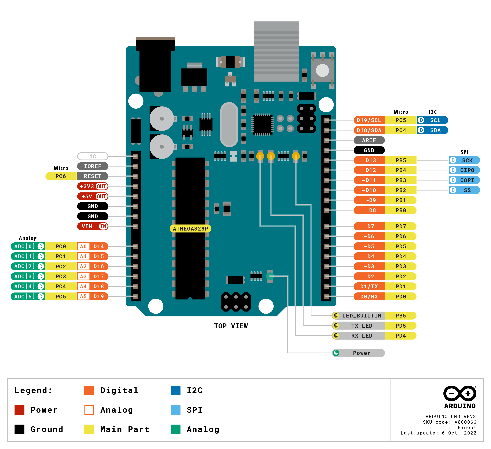

# Arduino Uno R3

The Arduino Uno R3 is the classic Arduino board. It is based on the
**ATmega328P** (8-bit AVR, 16 MHz) with 32 KB Flash, 2 KB SRAM and 1 KB
EEPROM. A second microcontroller, the **ATmega16U2**, works as USB to
serial converter.

* [Datasheet](datasheet-uno.pdf)
* [Schematic](Arduino_Uno_Rev3-schematic.pdf)


## Pinout



### Power Pins

* **VIN**: Input voltage when the board is powered via the barrel jack
    or this pin. The recommended range is 7V to 12V (limits 6V to 20V).
    The onboard regulator converts it to 5V.
* **5V**: Regulated 5V output from the onboard regulator or the USB
    port. You can also supply a regulated 5V here, but this bypasses the
    regulator and all protection, so be careful.
* **3V3**: 3.3V output from a small onboard regulator. You can draw
    50 mA.
* **GND**: Power/data/signal ground.
* **IOREF**: Provides the I/O voltage of the board (5V on the Uno).
    Shields use it to adapt their logic levels.
* **AREF**: External reference voltage for the ADC, used with
    `analogReference(EXTERNAL)`. Never apply more than 5V.
* **RESET**: Pull it `LOW` to reset the microcontroller.

The I/O pins work with **5V logic**. A single pin can deliver 20 mA
(40 mA absolute maximum), and the whole chip should not exceed 200 mA.


### Digital IO

The pins **D0 to D13** and **A0 to A5** (= D14 to D19) can be used as
digital GPIO. Unlike the ESP32-C3, the ATmega328P has **no strapping
pins**: the boot process does not depend on the level of any pin. After a
reset, all pins are inputs (high impedance) until the sketch configures
them.

Still, a few pins are *special* and are best avoided (or used with care):

* **D0 / RX and D1 / TX** Serial and Upload:
    These pins are connected to the ATmega16U2 (USB to serial converter)
    via 1 kOhm resistors. They are used by `Serial` and for uploading
    new firmware. Hardware connected to D0 can block the upload, and the
    serial communication will toggle D1.

    If you must use them: disconnect your circuit while uploading, and do
    not use `Serial` at the same time.

* **D13** LED_BUILTIN:
    D13 is connected to the onboard LED "L". On the Uno R3, the LED is
    driven by an operational amplifier (LMV358), so the pin itself is
    not loaded and can be used as input or output. Note that the
    **bootloader flashes the LED** after every reset, so anything
    connected to D13 sees a few short pulses at startup.

* **D10 to D13** SPI:
    These pins are used by the SPI interface and are also available on
    the ICSP header. **D10 (SS)** must be configured as `OUTPUT` when the
    ATmega328P is an SPI controller. If it is an input and is pulled
    `LOW`, the SPI hardware switches to peripheral mode.

* **A4 and A5** I2C:
    A4 and A5 are also connected to the SDA and SCL pins next to AREF.
    These are the **same signals**, not an additional I2C bus. When you
    use I2C, A4 and A5 are not available for analog input.

* **RESET** and Auto Reset:
    When the serial monitor opens the USB port, the ATmega16U2 resets the
    ATmega328P (via the DTR signal). This allows uploading without
    pressing the reset button, but it also **restarts the sketch** each
    time a serial connection is opened.

Special functions on the digital pins:

* **PWM** (`analogWrite()`): D3, D5, D6, D9, D10, D11 (marked with `~`)
* **External interrupts** (`attachInterrupt()`): D2 (INT0), D3 (INT1)
* **Pin change interrupts**: all digital and analog pins

Practical rule of thumb:

* **Best default GPIO choices**: Use **D2 to D9** for general purpose
    I/O. Use D2 and D3 for buttons or sensors that need an interrupt, and
    the PWM pins for LEDs, servos or motor drivers.

* **If you need every pin**: D10 to D13 and A0 to A5 are normal GPIOs as
    long as SPI and I2C are not used. Avoid D0 and D1 unless the sketch
    does not use `Serial`.


## Analog Inputs

The pins **A0 to A5** are connected to the 10-bit ADC (`analogRead()`
returns 0 to 1023). With the default reference of 5V, the resolution
is about 4.9 mV.

```C++
int value = analogRead(A0);                 // 0 to 1023
float voltage = value * 5.0 / 1023.0;       // 0V to 5V
```


## I2C

The I2C pins are fixed by the hardware:

* **A4 (D18, PC4)**: SDA

* **A5 (D19, PC5)**: SCL

Unlike the ESP32, the ATmega328P cannot route I2C to other pins, so
`Wire.begin()` has no pin parameters.

_Example:_ Arduino using I2C

```C++
#include <Wire.h>

void setup()
{
    Wire.begin();   // SDA = A4, SCL = A5
}
```


## UART

The Uno has only **one hardware UART**:

* **D1 (PD1)**: TX
* **D0 (PD0)**: RX

These pins are used for uploading and for `Serial`, which is connected
to the PC via the ATmega16U2.

_Example:_ Arduino using default Serial

```C++
void setup()
{
    Serial.begin(9600);
}
```

_Example:_ Arduino using SoftwareSerial

Because the hardware UART is already used for the USB connection, a
second serial port must be implemented in software. `SoftwareSerial`
works on most digital pins, but it is limited in speed (up to about
57600 baud reliably), and only one instance can receive at a time.

```C++
#include <SoftwareSerial.h>

SoftwareSerial gps(4, 5);   // RX, TX

void setup()
{
    Serial.begin(9600);
    gps.begin(9600);
}
```

Good pin choices for SoftwareSerial:

* Use D2 to D9, avoid D0/D1 (hardware UART) and D10 to D13 (SPI).

* These are ideal for: GPS modules, Bluetooth modules (HC-05),
    External MCUs, Sensors with UART


## PlatformIO

```ini
[env:uno]
platform = atmelavr
board = uno
framework = arduino
```

* On Linux, the Uno appears as `/dev/ttyACM0` (ATmega16U2 with the USB
    CDC driver).

* The Optiboot bootloader uses 512 bytes, so 32256 bytes of Flash are
    available for the sketch. The upload speed is 115200 baud.


## References

* [Arduino Docs: UNO R3](https://docs.arduino.cc/hardware/uno-rev3/)

* [Microchip: ATmega328P Datasheet][atmega328p]

[atmega328p]:
    https://www.microchip.com/en-us/product/ATmega328P

*Egon Teiniker, 2020-2026, GPL v3.0*
