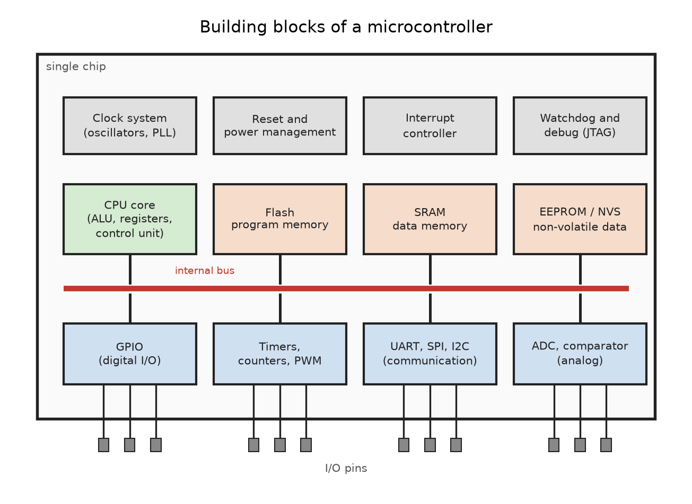
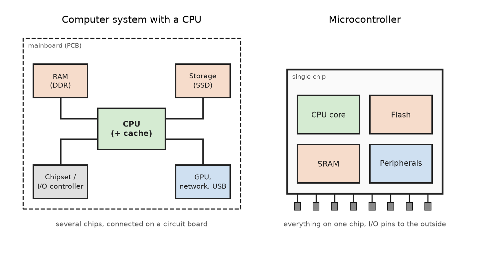
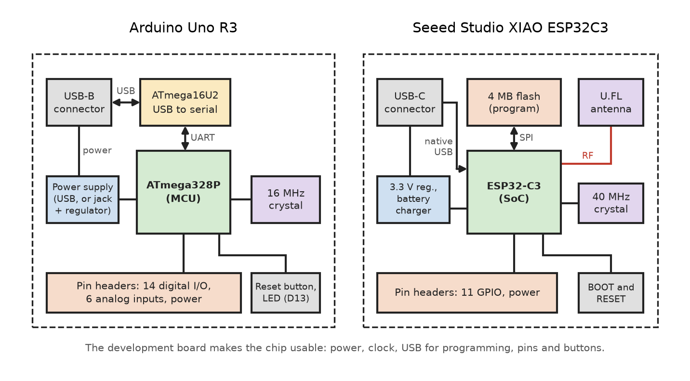

# Microcontrollers

A **microcontroller (MCU)** is a complete small computer on a single chip.
Besides a CPU core it contains program memory, data memory, and a set of
**peripherals** that connect the chip directly to the physical world:
digital I/O pins, timers, communication interfaces, and analog inputs.

Microcontrollers are built for **embedded systems**: devices that perform
a dedicated control task, often with real-time requirements, low power
consumption, and low cost.

## Building Blocks of a Microcontroller

* **CPU core**: Executes the program. It consists of the ALU, the
  register file, and the control unit (see [Processor Unit](../cpu/)).

* **Program memory (Flash)**: Non-volatile memory that stores the
  firmware. It keeps its content without power and can be reprogrammed
  many times.

* **Data memory (SRAM)**: Volatile memory for variables, the stack, and
  the heap. Its content is lost when power is removed.

* **Non-volatile data memory (EEPROM)**: Stores configuration and
  calibration data that must survive a power cycle.

* **Internal bus**: Connects the CPU with memories and peripherals.
  Peripherals are controlled through **registers** that are mapped into
  the address space of the CPU (memory-mapped I/O).

* **GPIO (General Purpose Input/Output)**: Digital pins that can be
  configured as input or output by software.

* **Timers and counters**: Measure time, count events, and generate
  periodic interrupts or **PWM** (Pulse Width Modulation) signals.

* **Communication interfaces**: Serial interfaces such as **UART**,
  **SPI**, and **I2C** to connect sensors, displays, or other chips.

* **Analog peripherals**: An **ADC** (Analog-to-Digital Converter)
  converts a voltage into a number. An analog comparator compares two
  voltages.

* **Interrupt controller**: Lets peripherals signal events to the CPU.
  The CPU interrupts the current program and executes an interrupt
  service routine (ISR).

* **Clock system**: Internal RC oscillators, external crystals, and PLLs
  generate the clock signals for the CPU and the peripherals.

* **Reset and power management**: Power-on reset, brown-out detection
  (reset on low supply voltage), and sleep modes to save energy.

* **Watchdog timer**: Resets the chip if the software hangs and stops
  resetting the watchdog regularly.

* **Debug interface**: Allows a debugger to stop the CPU, read registers
  and memory, and set breakpoints (e.g. JTAG, debugWIRE).

### Example: ATmega328P and ESP32-C3

| Block          | ATmega328P (Arduino Uno)  | ESP32-C3 (XIAO ESP32C3)       |
|:--             |:--                        |:--                            |
| CPU core       | 8-bit AVR, up to 20 MHz   | 32-bit RISC-V, up to 160 MHz  |
| Program memory | 32 KB flash (on chip)     | SPI flash (4 MB), 384 KB ROM  |
| Data memory    | 2 KB SRAM                 | 400 KB SRAM, 8 KB RTC SRAM    |
| EEPROM         | 1 KB                      | none (emulated in flash, NVS) |
| GPIO           | 23 I/O lines              | 22 GPIOs                      |
| Timers         | 2 x 8-bit, 1 x 16-bit     | 2 x 54-bit, 52-bit sys. timer |
| PWM            | 6 channels                | LED PWM, 6 channels           |
| Communication  | USART, SPI, TWI (I2C)     | 2 x UART, 3 x SPI, I2C, I2S   |
| More I/O       | none                      | TWAI (CAN), USB Serial/JTAG   |
| Analog         | 10-bit ADC, comparator    | 2 x 12-bit SAR ADC, temp.     |
| Wireless       | none                      | Wi-Fi 802.11 b/g/n, BLE 5     |
| Security       | lock bits                 | secure boot, AES, SHA, RSA    |
| Debug          | debugWIRE                 | JTAG via USB                  |

Some notable differences:

* The ATmega328P executes its program directly from on-chip flash. The
  ESP32-C3 executes code from an external (or in-package) SPI flash. The
  access is accelerated by a 16 KB **cache** taken from the SRAM.
* The ESP32-C3 has no EEPROM. The ESP-IDF and Arduino libraries emulate
  it with the **NVS** (Non-Volatile Storage) partition in flash.
* The 8 KB RTC SRAM of the ESP32-C3 stays powered in deep-sleep mode,
  so data can be kept between wake-ups.

## CPU versus Microcontroller

A **CPU** (or microprocessor) in a desktop computer, a laptop, or a server
contains only the processor cores and caches. RAM, storage, and most I/O
controllers are separate chips on the mainboard. A **microcontroller**
integrates all of these functions on one chip.

| Property         | CPU (microprocessor)       | Microcontroller            |
|:--               |:--                         |:--                         |
| Integration      | CPU cores and caches       | CPU, memory, peripherals   |
| Memory           | External RAM (GB)          | On-chip SRAM (KB)          |
| Program storage  | SSD or hard disk           | On-chip or SPI flash (KB)  |
| Clock frequency  | GHz                        | MHz                        |
| Word size        | 64 bit                     | 8, 16, or 32 bit           |
| Power            | Watts to hundreds of W     | Microwatts to milliwatts   |
| Software         | Operating system (Linux)   | Bare metal or RTOS         |
| Memory protection| MMU, virtual memory        | None or simple MPU         |
| I/O              | Through external chips     | Pins on the chip itself    |
| Timing           | High throughput            | Deterministic, real-time   |
| Cost             | High                       | Low (cents to a few euros) |
| Examples         | Intel Core, AMD Ryzen      | ATmega328P, ESP32-C3, STM32|

* A CPU is optimized for **performance**: complex operating systems,
  large amounts of data, many applications running in parallel.
* A microcontroller is optimized for **control**: reacting to inputs
  within a guaranteed time, running for years on a battery, and keeping
  the number of components on the circuit board small.

Without an operating system, the firmware of a microcontroller has full
control over the hardware. The program starts after reset and runs in an
endless loop (in Arduino: `setup()` and `loop()`).

## System on Chip (SoC)

A **System on Chip (SoC)** integrates all components of a complete
electronic system on a single chip. Compared to a classic microcontroller,
an SoC usually contains additional complex subsystems:

* radio transceivers and protocol stacks in hardware (Wi-Fi, Bluetooth)
* cryptographic accelerators and security functions
* DMA controllers, USB controllers, or graphics units
* sometimes several processor cores

The boundary between MCU and SoC is not sharp. The **ESP32-C3** is
described by Espressif as an SoC: besides the RISC-V CPU, the memories,
and the peripherals, it contains the complete 2.4 GHz RF front end
(transmitter, receiver, balun, antenna switch), the Wi-Fi and Bluetooth
LE baseband and MAC, cryptographic accelerators (AES, SHA, RSA, HMAC,
RNG), and a power management unit. Only a crystal, flash memory (if not
in the package), and an antenna are needed externally.

SoCs exist in all performance classes:

* **MCU-class SoC**: ESP32-C3, runs bare metal or FreeRTOS
* **Application processor SoC**: Broadcom BCM2711 of the Raspberry Pi 4
  (four ARM Cortex-A72 cores, GPU, video codecs), runs Linux and needs
  external RAM

Chip manufacturers often sell SoCs also as **modules**, small certified
boards with the chip, flash, crystal, and antenna (e.g. ESP32-C3-MINI-1).
A module simplifies the hardware design because the RF part is already
tested and certified.

## MCU Development Boards

A bare microcontroller chip cannot be used directly. It needs a power
supply, a clock source, a way to load the firmware, and connections to
the pins. A **development board** provides all of this, so the chip can
be used on a breadboard and programmed from a computer via USB.

Typical components of a development board:

* **Power supply**: Voltage regulators convert the USB voltage (5 V), a
  battery, or an external supply to the operating voltage of the chip.
* **Clock source**: A crystal provides a precise clock frequency.
* **USB interface**: Used for uploading the firmware and for serial
  communication (Serial Monitor). Either a separate USB-to-serial
  converter chip or the native USB controller of the MCU is used.
* **Bootloader**: A small program in the MCU that receives new firmware
  over the serial or USB connection and writes it into flash. No
  external programmer is needed.
* **Pin headers**: Make the GPIO pins accessible for breadboards and
  jumper wires.
* **Buttons and LEDs**: Reset button, boot button, power LED, and a user
  LED for first tests.

### Example: Arduino Uno R3

* ATmega328P running at 16 MHz (external crystal), 5 V operating voltage
* An additional **ATmega16U2** acts as **USB-to-serial converter**,
  because the ATmega328P has no USB interface
* A bootloader in the boot section of the flash receives the firmware
  over the serial connection
* 14 digital I/O pins (6 with PWM), 6 analog inputs
* LED on pin 13, reset button, ICSP header for an external programmer

### Example: Seeed Studio XIAO ESP32C3

* ESP32-C3 running at up to 160 MHz, 3.3 V operating voltage
* 4 MB flash connected via SPI
* No USB-to-serial chip: the **native USB Serial/JTAG controller** of
  the ESP32-C3 is used for uploading, serial output, and debugging
  (appears as `/dev/ttyACM0` on Linux)
* The ROM bootloader is entered with the BOOT button during reset
* 11 GPIO pins (4 can be used as analog inputs)
* Battery charging circuit, U.FL connector for an external antenna
* Very small form factor (21 x 17.8 mm)

In this repository, both boards are programmed with **PlatformIO**. The
`board` setting in `platformio.ini` tells PlatformIO which chip is used,
how to compile for its instruction set, and how to upload the firmware.

## References

* [ATmega328P Datasheet](../atmega328p/datasheet-ATmega328P.pdf)
* [ESP32-C3 Series Datasheet](../esp32-c3/esp32-c3_datasheet_en.pdf)
* [Arduino UNO R3 Documentation](https://docs.arduino.cc/hardware/uno-rev3/)
* [Getting Started with Seeed Studio XIAO ESP32C3][xiao]
* Jim Ledin. **Modern Computer Architecture and Organization**.
  Packt Publishing, 2020

[xiao]: https://wiki.seeedstudio.com/XIAO_ESP32C3_Getting_Started/

*Egon Teiniker, 2020-2026, GPL v3.0*
