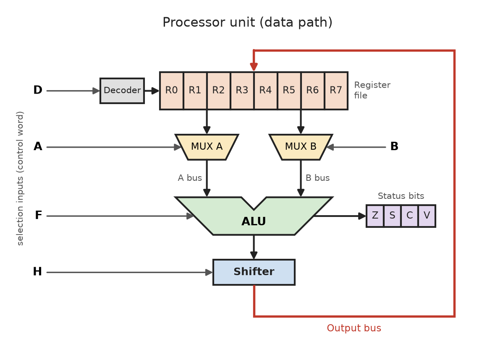
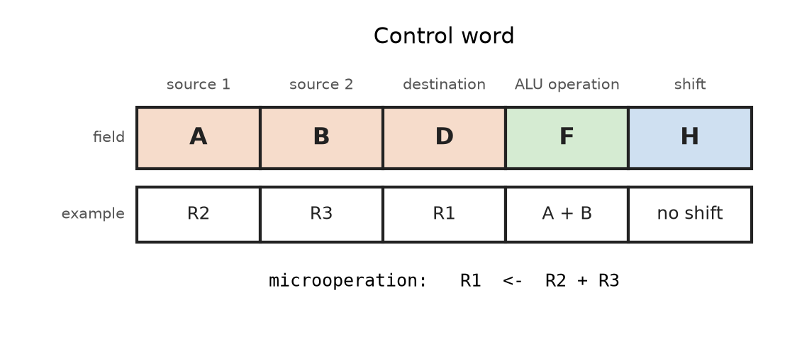
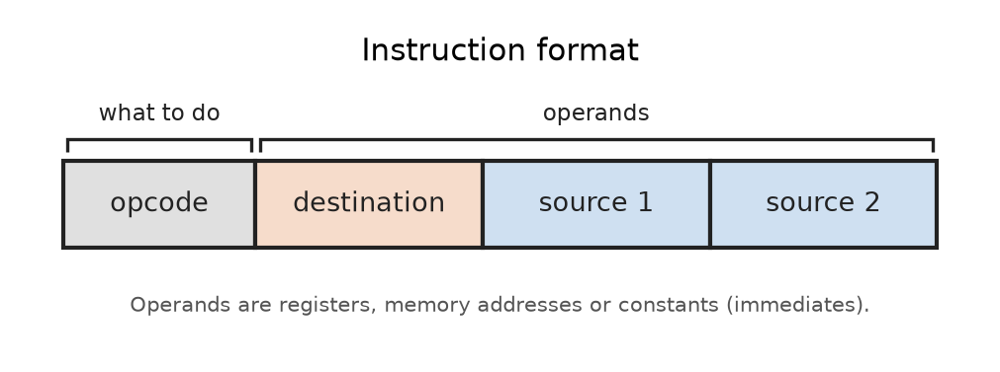
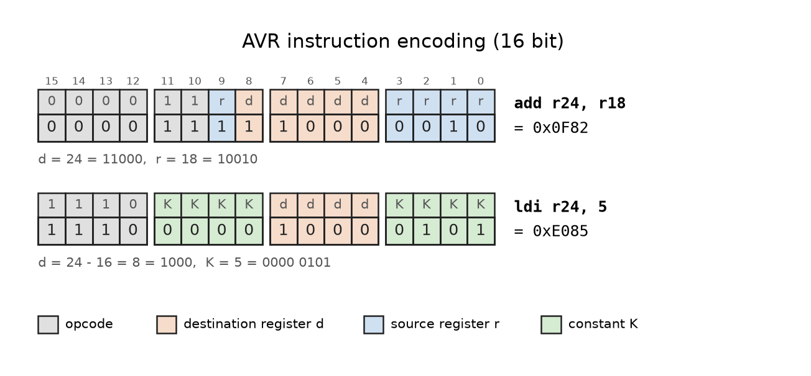
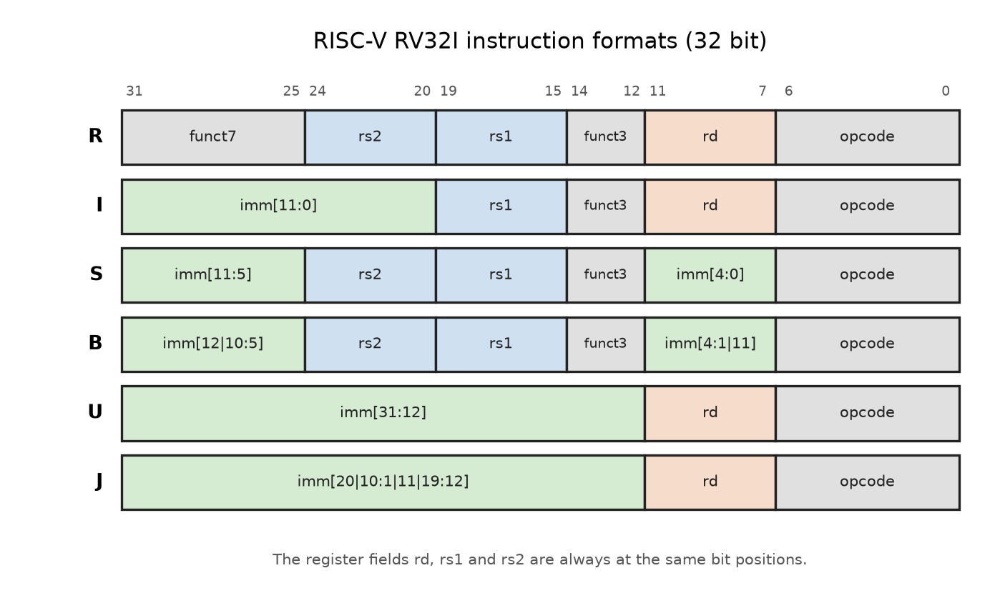
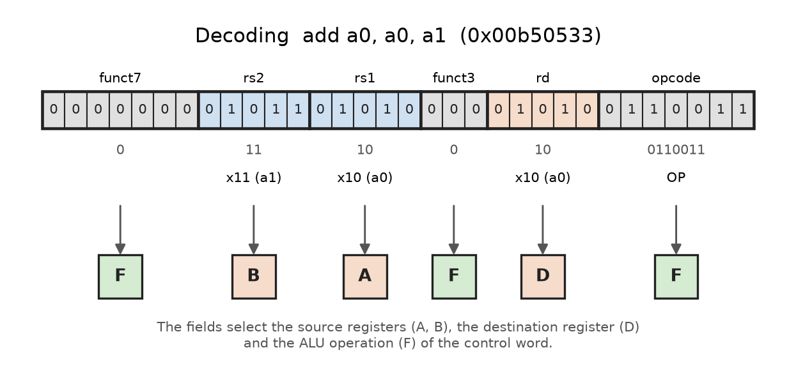
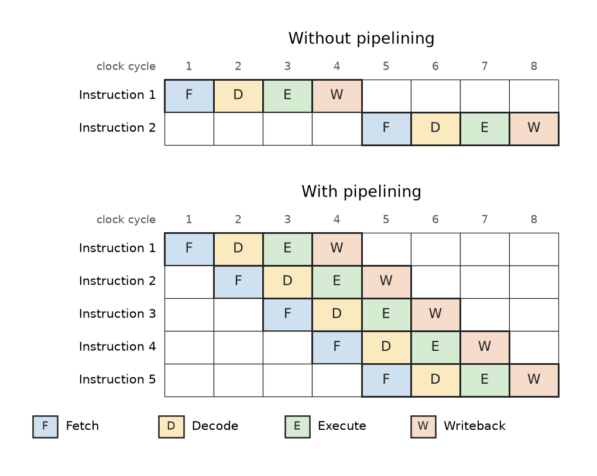

# Processor Unit

The processor unit (CPU) is the central component of a digital computer.
It consists of a set of **registers** and the digital circuits that
implement the **microoperations** on the data stored in these registers.

The processor part is often called the **data path**, because it forms the
paths for the operations among the registers. The paths are built from
buses and multiplexers, whose selection lines are driven by the
**control unit**.



The building blocks of a processor unit are:

* **Register file**: Each register is connected to two multiplexers which
  form the input buses A and B. The selection inputs A and B choose the
  register for each bus.

* **ALU**: Both buses are applied to the inputs of the arithmetic logic
  unit. The selection inputs F choose the operation.

* **Shifter**: The ALU result can be shifted left or right, or passed
  through unchanged, depending on the selection inputs H.

* **Output bus and destination decoder**: The result is placed on the
  output bus, which is connected to all registers. A decoder (D) activates
  the load input of exactly one destination register.

* **Status bits**: Flags that describe the result of the last ALU
  operation. They are used by conditional branch instructions.

| Flag | Name     | Meaning                                                  |
|:--   |:--       |:--                                                       |
| Z    | Zero     | The result is zero.                                      |
| S/N  | Sign     | The result is negative (MSB of a two's complement value).|
| C    | Carry    | Carry out (addition) or borrow (subtraction) of the MSB. |
| V    | Overflow | Signed result does not fit into the given number of bits.|

All selection variables must be stable at the beginning of a clock period.
The data from the source registers must propagate through the
multiplexers, the ALU, the shifter, and into the destination register
within **one clock period**.


## Arithmetic Logical Unit

### Arithmetic Circuit

The basic component of an arithmetic circuit is the **parallel adder**
(n full adders). The B inputs pass through a combinatorial circuit
(n multiplexers) to the Y inputs of the adder, which calculates:

```
F = A + Y + Cin
```

By controlling Y with the selection inputs S1 and S0, a variety of
arithmetic operations is obtained:

| S1 | S0 | Y       | F (Cin = 0)           | F (Cin = 1)                 |
|:--:|:--:|:--      |:--                    |:--                          |
| 0  | 0  | all 0s  | F = A (transfer)      | F = A + 1 (increment)       |
| 0  | 1  | B       | F = A + B (add)       | F = A + B + 1               |
| 1  | 0  | B̅       | F = A + B̅             | F = A + B̅ + 1 (subtract)    |
| 1  | 1  | all 1s  | F = A - 1 (decrement) | F = A (transfer)            |

* Subtraction is an addition of the **two's complement** of B
  (B̅ + 1).
* Adding all 1s means adding -1 in two's complement, which gives a
  decrement.

### Logic Circuit

Logic microoperations treat each bit of a register as a binary variable.
Four basic operations are sufficient to derive all others: AND, OR, XOR,
and NOT. Each one is implemented by a gate, and a multiplexer selects
the result.

| S1 | S0 | Output           |
|:--:|:--:|:--               |
| 0  | 0  | F = A AND B      |
| 0  | 1  | F = A OR B       |
| 1  | 0  | F = A XOR B      |
| 1  | 1  | F = A̅            |

### Arithmetic Unit and Logic Unit

Both circuits share the selection variables S1 and S0. A third selection
variable S2 chooses between them: S2 = 0 selects the arithmetic output,
S2 = 1 selects the logic output. Together with Cin this gives 12 different
ALU operations.


## Shifter Unit

The shifter transfers the output of the ALU onto the output bus. It can
shift the data to the left or right, or transfer it without change.

| H1 | H0 | Operation            | Function                  |
|:--:|:--:|:--                   |:--                        |
| 0  | 0  | S <- F               | Transfer F to S           |
| 0  | 1  | S <- shift left F    | Shift left F into S       |
| 1  | 0  | S <- shift right F   | Shift right F into S      |
| 1  | 1  | S <- 0               | Transfer 0s into S        |

A shift left by one bit multiplies an unsigned value by 2, a shift right
divides it by 2.


## Control Word and Control Unit

### Control Word

The selection variables control the buses, the ALU, the shifter, and the
destination register during one clock period. Together they form a
**control word** with five fields:



* **A**: source register for the first ALU input
* **B**: source register for the second ALU input
* **D**: destination register
* **F**: one of the 12 ALU operations
* **H**: type of shift

A control word applied to the selection inputs specifies exactly one
**microoperation**, for example `R1 <- R2 + R3`.

The most efficient way to generate control words is to store them in a
memory unit, the **control memory**. Reading consecutive control words
from this memory executes a sequence of microoperations. This type of
control organization is called **microprogramming**.

### Control Unit

The control unit directs the overall processor operation. Registers, ALU,
memory, and I/O devices respond to commands initiated by the control unit.

During reset, the processor initializes its internal components and loads
the **Program Counter (PC)** with the address of the first instruction.
The PC always holds the address of the **next** instruction.

**Instruction execution cycle**:

1. **Fetch**: Read the instruction word at the address in the PC and load
   it into the internal instruction register. The PC is advanced.
2. **Decode**: Interpret the opcode bits to determine the required actions.
   Depending on the opcode, additional words (addresses or data) are read.
3. **Execute**: Activate the circuitry for the operation (register access,
   memory access, ALU operation, ...).
4. **Writeback**: Store the result in a register or memory location and
   update the PC.

One **machine instruction** is executed as a sequence of one or more
**microoperations** (control words).


## Instruction Set Architecture

The **Instruction Set Architecture (ISA)** is the interface between
hardware and software. It defines everything a programmer (or compiler)
must know to write correct machine code for a processor:

* the available **instructions** and their **binary encoding**
* the **registers** visible to the programmer (general purpose registers,
  PC, stack pointer, status register)
* the **data types** and word sizes
* the **addressing modes**, i.e. how operands are found
* the **memory model** (address spaces, byte order, I/O access)

Every CPU family has its own instruction set. Machine code compiled for
an AVR (Arduino Uno) cannot run on a RISC-V (ESP32-C3) and vice versa.
Different chips that implement the same ISA can execute the same binary.

### Instruction Format

An instruction is a group of bits. The most basic part is the
**operation code (opcode)**, which specifies the operation to be performed
(e.g. `add`, `sub`, `mov`). The remaining bits specify the **operands**:
the registers, memory addresses, or constant values (immediates) the
operation works on.



Instructions can have a **fixed length** (all instructions use the same
number of bits, which simplifies decoding) or a **variable length**
(compact code, but more complex decoding).

### Machine Code and Assembly Language

The processor only understands **machine code**, the binary encoded
instructions. **Assembly language** is a human readable notation in which
each line corresponds to exactly one machine instruction. The **assembler**
translates mnemonics (`add`, `ldi`, `brne`) into binary opcodes.
For example, the C statement `a = a + b;` can become `add r24, r18` and
`a = 5;` can become `ldi r24, 5` on the AVR:



* `add Rd, Rr` is encoded as `0000 11rd dddd rrrr`. The 5 bits of the
  destination register `d` and of the source register `r` are spread over
  the instruction word.
* `ldi Rd, K` is encoded as `1110 KKKK dddd KKKK`. The 8 bit constant `K`
  is embedded into the instruction. Only 4 bits are left for `d`, so `ldi`
  can only access the registers r16 to r31.

The instruction encoding is a tradeoff between the number of instructions,
the number of registers, and the size of constants that fit into one word.

### Instruction Categories

Most instruction sets provide the following groups of instructions:

* **Data transfer**: copy data between registers and memory
  * AVR: `mov`, `ldi`, `ld`, `st`, `lds`, `sts`, `push`, `pop`
  * RISC-V: `mv`, `li`, `lw`, `sw`, `lb`, `sb`, `lui`
* **Arithmetic**: integer calculations
  * AVR: `add`, `adc`, `sub`, `sbc`, `inc`, `dec`, `mul`
  * RISC-V: `add`, `addi`, `sub`, `mul`, `div`, `rem`
* **Logic**: bitwise operations
  * AVR: `and`, `andi`, `or`, `ori`, `eor`, `com`
  * RISC-V: `and`, `andi`, `or`, `ori`, `xor`, `xori`
* **Shift and rotate**: move bits left or right
  * AVR: `lsl`, `lsr`, `asr`, `rol`, `ror`
  * RISC-V: `sll`, `srl`, `sra`, `slli`, `srli`, `srai`
* **Compare and test**: evaluate a condition without storing a result
  * AVR: `cp`, `cpc`, `cpi`, `tst` (set the status flags)
  * RISC-V: `slt`, `sltu`, `slti` (write 0 or 1 into a register)
* **Control flow**: change the PC (jumps, branches, calls)
  * AVR: `rjmp`, `jmp`, `breq`, `brne`, `brge`, `rcall`, `call`, `ret`
  * RISC-V: `j`, `jal`, `jalr`, `beq`, `bne`, `blt`, `bge`, `ret`
* **Bit and I/O**: access peripheral registers
  * AVR: `in`, `out`, `sbi`, `cbi`, `sbic`, `sbis`
  * RISC-V: no special instructions, memory-mapped (`lw`, `sw`)
* **System**: processor control
  * AVR: `nop`, `sleep`, `sei`, `cli`, `wdr`, `reti`
  * RISC-V: `ecall`, `ebreak`, `csrrw`, `wfi`, `mret`

Each instruction category maps directly to the building blocks of the
processor unit:

* arithmetic and logic instructions use the **ALU**
* shift instructions use the **shifter**
* compare instructions update the **status bits**
* conditional branches read the **status bits** and modify the **PC**

### Addressing Modes

The addressing mode defines how the processor finds an operand.

| Mode               | AVR example        | RISC-V example     |
|:--                 |:--                 |:--                 |
| Immediate          | `ldi r24, 5`       | `addi a0, a0, 5`   |
| Register direct    | `add r24, r18`     | `add a0, a0, a1`   |
| Data direct        | `lds r24, 0x0100`  | (not available)    |
| Register indirect  | `ld r24, X`        | `lw a0, 0(a1)`     |
| Displacement       | `ldd r24, Y+3`     | `lw a5, 8(sp)`     |
| Post-inc / pre-dec | `ld r24, X+`       | (not available)    |
| PC relative        | `rjmp .L3`         | `beq a0, a1, .L2`  |

* **Immediate**: The operand is a constant inside the instruction.
* **Register direct**: The operand is the content of a register.
* **Data direct**: The memory address is part of the instruction.
* **Register indirect**: A register holds the memory address (pointer).
* **Indirect with displacement**: The address is a register plus a
  constant offset.
* **Post-increment / pre-decrement**: Indirect access, the pointer
  register is updated automatically (useful for loops over arrays).
* **PC relative**: The target address is the PC plus an offset (used for
  branches and jumps).

Indirect addressing with displacement is used to access local variables
on the stack (relative to the stack or frame pointer) and elements of
structs and arrays.

### CISC versus RISC

A processor architecture is a tradeoff between the number of registers and
the number and complexity of the instructions.

| Property           | CISC                    | RISC                      |
|:--                 |:--                      |:--                        |
| Instruction set    | Large, complex          | Small, simple             |
| Instruction length | Variable (x86: 1-15 B)  | Fixed (16 or 32 bit)      |
| Memory operands    | Most instructions       | Only load and store       |
| Clock cycles       | Many per instruction    | Mostly one per instruction|
| Registers          | Few                     | Many general purpose      |
| Control unit       | Often microprogrammed   | Hardwired, pipelined      |
| Examples           | x86, x86-64             | ARM, AVR, RISC-V          |

* **CISC (Complex Instruction Set Computer)**: One instruction can load an
  operand from memory, perform an operation, and store the result back to
  memory. Such an instruction takes many clock cycles.

* **RISC (Reduced Instruction Set Computer)**: The same operation needs
  separate instructions: load the operands into registers, perform the
  operation, and store the result back to memory (**load-store
  architecture**). The simpler logic leaves room for more registers.

### Example: The Same Function on Different ISAs

The following C function is compiled for three different processors
(see [Compiler Explorer](https://godbolt.org/)):

```C
int max_value(int a, int b)
{
    if(a > b)
        return a;
    else
        return b;
}
```

**CISC: x86-64 (gcc 10.2, no optimization)**

```asm
max_value:
        push    rbp
        mov     rbp, rsp
        mov     DWORD PTR [rbp-4], edi     ; store a on the stack
        mov     DWORD PTR [rbp-8], esi     ; store b on the stack
        mov     eax, DWORD PTR [rbp-4]
        cmp     eax, DWORD PTR [rbp-8]     ; compare register with memory
        jle     .L2
        mov     eax, DWORD PTR [rbp-4]     ; return a
        jmp     .L3
.L2:
        mov     eax, DWORD PTR [rbp-8]     ; return b
.L3:
        pop     rbp
        ret
```

Note that `cmp` uses one operand directly from memory. This is typical for
a CISC instruction set.

**RISC: AVR ATmega328P (Arduino Uno, no optimization)**

```asm
max_value:
        push r28                ; save frame pointer Y (r29:r28)
        push r29
        rcall .                 ; reserve 4 bytes on the stack
        rcall .
        in r28,__SP_L__         ; Y = stack pointer
        in r29,__SP_H__
        std Y+2,r25             ; store a (r25:r24) on the stack
        std Y+1,r24
        std Y+4,r23             ; store b (r23:r22) on the stack
        std Y+3,r22
        ldd r18,Y+1             ; load a into r19:r18
        ldd r19,Y+2
        ldd r24,Y+3             ; load b into r25:r24
        ldd r25,Y+4
        cp r24,r18              ; compare low bytes
        cpc r25,r19             ; compare high bytes with carry
        brge .L2                ; branch if b >= a (signed)
        ldd r24,Y+1             ; return a
        ldd r25,Y+2
        rjmp .L3
.L2:
        ldd r24,Y+3             ; return b
        ldd r25,Y+4
.L3:
        pop __tmp_reg__         ; free the 4 bytes
        pop __tmp_reg__
        pop __tmp_reg__
        pop __tmp_reg__
        pop r29                 ; restore frame pointer
        pop r28
        ret
```

The AVR is an 8-bit processor, but an `int` has 16 bits on this platform.
Each 16-bit value occupies a register pair, and every operation is split
into two 8-bit instructions. The comparison `cp` / `cpc` shows how the
carry flag connects the low and the high byte. Memory is accessed only
with `ld`/`st` instructions (load-store architecture).

**RISC: RISC-V RV32IMC (XIAO ESP32C3, no optimization)**

```asm
max_value:
        addi    sp,sp,-32       ; reserve stack frame
        sw      ra,28(sp)       ; save return address
        sw      s0,24(sp)       ; save frame pointer
        addi    s0,sp,32
        sw      a0,-20(s0)      ; store a on the stack
        sw      a1,-24(s0)      ; store b on the stack
        lw      a4,-20(s0)
        lw      a5,-24(s0)
        ble     a4,a5,.L2       ; compare and branch in one instruction
        lw      a5,-20(s0)      ; return a
        j       .L3
.L2:
        lw      a5,-24(s0)      ; return b
.L3:
        mv      a0,a5           ; return value in a0
        lw      ra,28(sp)
        lw      s0,24(sp)
        addi    sp,sp,32
        jr      ra
```

RISC-V has no status flags. A conditional branch such as `ble` compares two
registers directly. With optimization (`-Os`) the function shrinks to three
instructions:

```
Address  Machine code   Assembly
   0:    00b55363       bge   a0,a1,6 <.L2>     ; 32-bit instruction
   4:    852e           mv    a0,a1             ; 16-bit compressed
   6:    8082           ret                     ; 16-bit compressed
```

### Example: AVR Instruction Set (ATmega328P)

* 8-bit RISC architecture with about 130 instructions
* 32 general purpose registers r0 to r31 (8 bit), most instructions
  execute in a **single clock cycle**
* The register pairs r27:r26, r29:r28, and r31:r30 form the 16-bit
  pointer registers **X**, **Y**, and **Z** for indirect addressing
* Instructions are 16 or 32 bits wide, the flash is organized as
  16K x 16 bit words
* The status register **SREG** contains the flags C, Z, N, V, S, H, T,
  and I (global interrupt enable)
* Special instructions for the I/O registers: `in`, `out`, `sbi`, `cbi`,
  `sbic`, `sbis`

In a typical ALU operation, two operands are read from the register file,
the operation is executed, and the result is stored back in the register
file, all in one clock cycle.

### Example: RISC-V Instruction Set (ESP32-C3)

* 32-bit RISC architecture, an open and royalty free ISA
* Modular design: the base integer set **RV32I** (about 40 instructions)
  is combined with extensions. The ESP32-C3 implements **RV32IMC**:
  * **I**: base integer instructions
  * **M**: integer multiplication and division
  * **C**: compressed 16-bit encodings of common instructions
* 32 registers x0 to x31 (32 bit). **x0 is hardwired to zero**.
  The ABI names describe their usage: `ra` (return address), `sp` (stack
  pointer), `a0` to `a7` (arguments and return values), `s0` to `s11`
  (saved registers), `t0` to `t6` (temporaries)
* Pure load-store architecture, no status flags
* Only six instruction formats with fixed bit positions for the
  register fields, which makes decoding simple and fast:



| Format | Used for               | Example           | Machine code |
|:--     |:--                     |:--                |:--           |
| R      | register operations    | `add a0,a0,a1`    | `0x00b50533` |
| I      | immediates, loads      | `addi a0,a0,5`    | `0x00550513` |
| I      | immediates, loads      | `lw a5,8(sp)`     | `0x00812783` |
| S      | stores                 | `sw a5,8(sp)`     | `0x00f12423` |
| B      | conditional branches   | `beq a0,a1,16`    | `0x00b50863` |
| U      | upper immediate        | `lui a0,0x60004`  | `0x60004537` |
| J      | jump and link (call)   | `jal ra,64`       | `0x040000ef` |

The decoding of `add a0,a0,a1` (`0x00b50533`) shows how an instruction
word is mapped to the fields of the control word:



The opcode and funct fields select the ALU operation (F), rs1 and rs2
select the source registers (A, B), and rd selects the destination
register (D).


## Processor and Memory Architectures

### Von Neumann Architecture

Introduced by John von Neumann in 1945. The processor consists of a
control unit, an ALU, a register set, and **one memory region for both
program instructions and data**.

* Conceptually simple for programmers and circuit designers.
* **Bottleneck**: Instructions and data share one memory interface, so
  multiple memory cycles are needed to fetch an instruction and its data.
  Caches mitigate this limitation.
* **Security**: Data can be executed as instructions (self-modifying code).
  Buffer overflow attacks exploit this to inject and run malicious code.

### Harvard Architecture

First implemented in the Harvard Mark I computer in 1944. A strict Harvard
architecture uses **separate address spaces and buses for instructions and
data**.

* Instructions and data can be accessed **simultaneously**, which
  increases performance.
* Requires duplicate address lines, data lines, and control signals.
* Removes the class of attacks that execute data as code, as long as the
  instruction memory cannot be modified by the program.

### Example: AVR Memories (ATmega328P)

The ATmega328P uses a Harvard architecture:

* **Flash program memory**: 32 KB, organized as 16K x 16 bit, divided into
  a boot loader section and an application section.
* **SRAM data memory**: The first 32 addresses map the register file, the
  next 64 the standard I/O registers, then 160 extended I/O registers,
  followed by 2048 bytes of internal SRAM.
* **EEPROM**: 1 KB in a separate data space, accessed through I/O
  registers.

Because program and data memory are separate, constants stored in flash
must be read with the special instruction `lpm` (load program memory).

### Input / Output Devices

* **Memory-mapped I/O**: Peripheral registers occupy addresses in the
  system address space and are accessed with ordinary load and store
  instructions. This reduces the available address space for memory.
  RISC-V uses memory-mapped I/O.
* **Port-mapped I/O**: I/O devices have a separate address space (port
  numbers) and are accessed with dedicated instructions. The x86
  architecture uses port-mapped I/O.

The AVR combines both: its 64 I/O registers (PORT, PIN, DDR, ...) are
mapped into the data memory directly after the 32 working registers, and
special instructions (`in`, `out`, `cbi`, `sbi`, `sbic`, `sbis`) provide
fast access to them.


## Performance-Enhancing Techniques

### Cache Memory

A cache is a small, fast memory that stores recently used instructions or
data for future use. It must be significantly faster than the original
source of the data (**backing store**).

* **Cache hit**: The data is found in the cache and used immediately.
* **Cache miss**: The data is read from the backing store and a copy is
  placed in the cache.

Caches work because programs show **locality of reference**: recently used
data is likely to be used again (temporal locality), and data near
recently used data is likely to be accessed next (spatial locality).

### Instruction Pipelining

The execution of an instruction is split into the steps **fetch**,
**decode**, **execute**, and **writeback**. Without pipelining, the
hardware for three of the four steps is idle at any time.

In a pipeline, the fetch unit starts fetching the next instruction as soon
as it has finished the current one. Several instructions are in different
stages of execution simultaneously. In the same 8 clock cycles, the
pipelined processor completes 5 instructions instead of 2.



Simple, fixed-length RISC instructions are well suited for pipelining.
The AVR uses a two-stage pipeline: the next instruction is fetched while
the current one is executed.


## References

* Jim Ledin. **Modern Computer Architecture and Organization**.
  Packt Publishing, 2020
* M. Morris Mano. **Computer Engineering: Hardware Design**.
  Prentice Hall, 1988
* Andrew S. Tanenbaum. **Structured Computer Organization**.
  Pearson Education, International Edition 2013
* [Microchip: AVR Instruction Set Manual][avr-isa]
* [The RISC-V Instruction Set Manual](https://riscv.org/specifications/)
* [Espressif: ESP32-C3 Technical Reference Manual][esp32c3-trm]
* [Compiler Explorer](https://godbolt.org/)

[avr-isa]: https://ww1.microchip.com/downloads/en/DeviceDoc/AVR-Instruction-Set-Manual-DS40002198A.pdf
[esp32c3-trm]: https://www.espressif.com/sites/default/files/documentation/esp32-c3_technical_reference_manual_en.pdf

*Egon Teiniker, 2020-2026, GPL v3.0*
