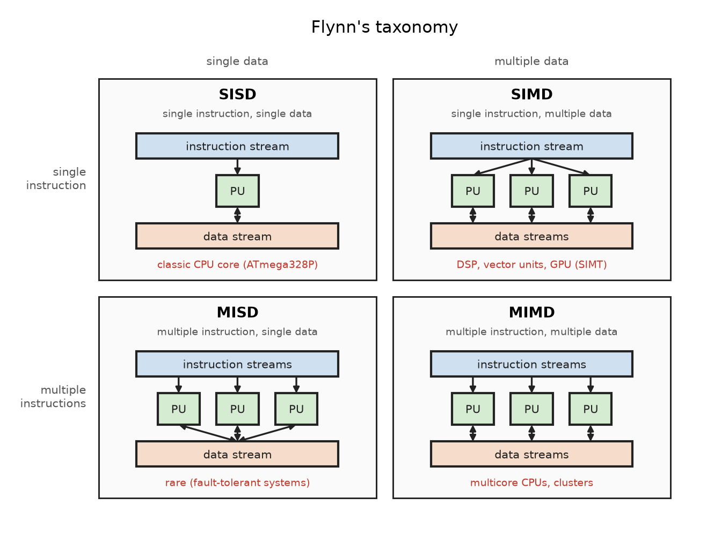
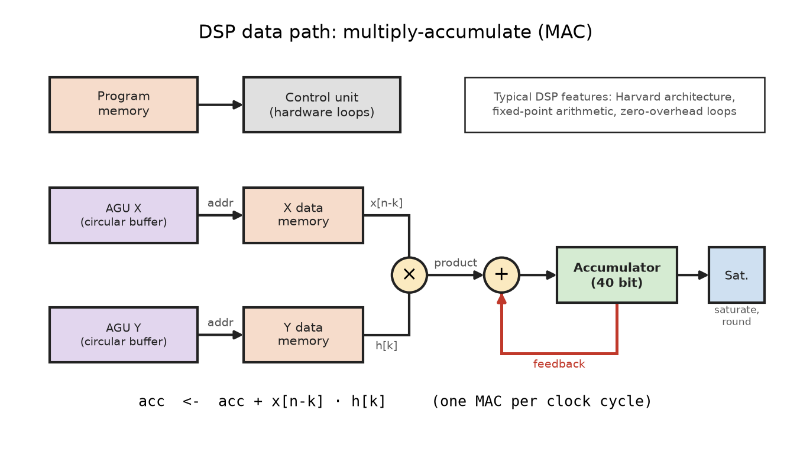
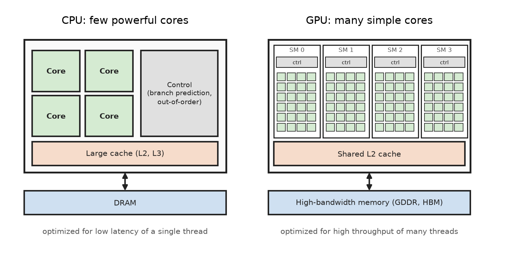
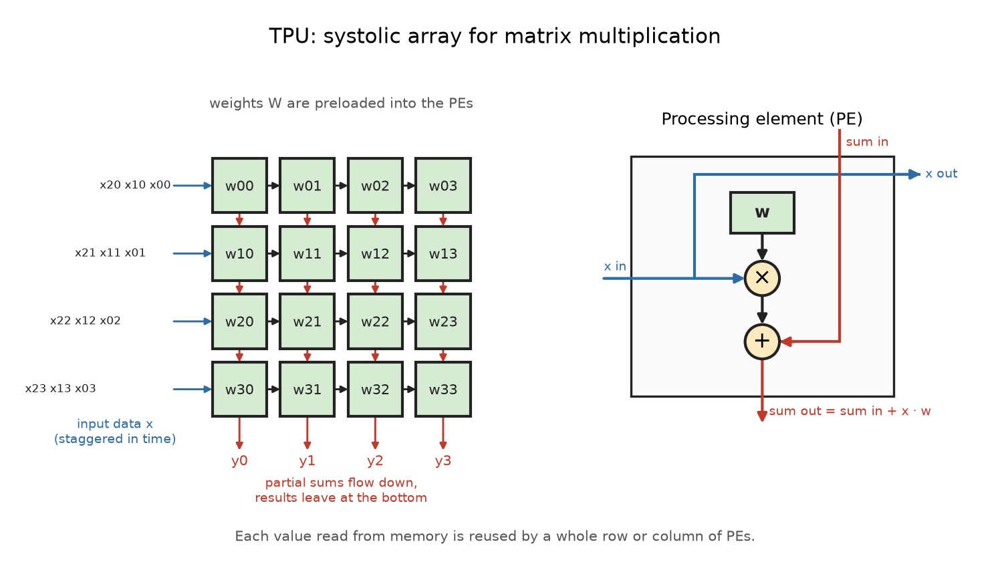

# Specialized Processors

The CPU cores of the ATmega328P and the ESP32-C3 are **general-purpose
processors**: they can execute any program, and their instruction set is
designed to handle a wide range of tasks reasonably well.

For some workloads, a **specialized processor** is much faster and more
energy efficient. Specialization means to spend the chip area on exactly
the operations a workload needs (e.g. multiplications) and to remove
everything else (e.g. complex control logic). The price is flexibility:
a specialized processor is only good at its specific task.


## Flynn's Taxonomy

A classic way to classify processor architectures is **Flynn's taxonomy**
(1966). It distinguishes architectures by the number of instruction
streams and data streams that are processed at the same time.



* **Single Instruction, Single Data (SISD)**: One instruction operates on
  one data element. This is the classic von Neumann processor, like the
  AVR core of the ATmega328P.

* **Single Instruction, Multiple Data (SIMD)**: One instruction operates
  on many data elements in parallel. Examples are vector instructions
  (e.g. ARM NEON, x86 SSE/AVX), DSPs, and GPUs.

* **Multiple Instruction, Single Data (MISD)**: Several instructions
  operate on the same data. This is rare and mostly used in
  fault-tolerant systems that compute the same result redundantly.

* **Multiple Instruction, Multiple Data (MIMD)**: Independent processors
  execute different programs on different data. Examples are multicore
  CPUs and computer clusters.

The specialized processors in this chapter mainly exploit **data-level
parallelism** (SIMD): the same operation is applied to large amounts of
data.


## Digital Signal Processor (DSP)

A **Digital Signal Processor (DSP)** is optimized for processing
continuous streams of sampled signals in real time, e.g. audio, radio,
or sensor signals. Typical algorithms are digital filters, the Fast
Fourier Transform (FFT), and control loops in motor drives.

Most of these algorithms are built from the same basic operation. A
**FIR filter** (Finite Impulse Response) computes each output sample as
a weighted sum of the last N input samples:

$$
y[n] = \sum_{k=0}^{N-1} h[k] \cdot x[n-k]
$$

For each output sample, the processor must load N samples and N
coefficients, perform N multiplications, and add N products. A DSP is
built to execute one such **multiply-accumulate (MAC)** step per clock
cycle.



### Building Blocks

* **MAC unit**: A hardware multiplier directly connected to an adder.
  The operation `acc <- acc + x * h` takes a single clock cycle.

* **Wide accumulator**: The product of two 16-bit numbers has 32 bits.
  An accumulator with additional **guard bits** (e.g. 40 bit) can add
  many products without overflow.

* **Modified Harvard architecture**: Separate program memory and often
  **two data memories** (X and Y) with their own buses. An instruction,
  a sample, and a coefficient can be read in the same clock cycle.

* **Address Generation Units (AGU)**: Calculate the operand addresses in
  parallel to the ALU. They support **circular buffers** (modulo
  addressing), so the oldest sample is overwritten automatically, and
  **bit-reversed addressing** for the FFT.

* **Zero-overhead loops**: The loop counter and the jump back are
  handled in hardware. A loop over the filter taps needs no extra
  instructions for incrementing, comparing, and branching.

* **Saturation arithmetic**: On overflow, the result is clamped to the
  largest or smallest representable value instead of wrapping around.
  A wrapped-around audio sample would cause a loud click.

* **Fixed-point arithmetic**: Many DSPs work with fractional numbers in
  **Q format**. In Q15, a 16-bit integer represents a value between -1
  and 1 (the integer divided by 2^15). Fixed-point hardware is smaller,
  faster, and needs less energy than floating-point hardware.

### Example: FIR Filter

On a general-purpose processor, each filter tap needs several
instructions: two loads, a multiplication, an addition, a pointer update
with wrap-around, a counter decrement, and a conditional branch.

```C
int32_t fir(const int16_t *h, const int16_t *x, int n, int N)
{
    int32_t acc = 0;
    for(int k = 0; k < N; k++)
    {
        int idx = (n - k) & (N - 1);    // circular buffer, N = 2^m
        acc += (int32_t)h[k] * x[idx];  // multiply-accumulate
    }
    return acc;
}
```

On a DSP, the loop body becomes a **single MAC instruction** inside a
hardware loop. The AGUs update both pointers (including the wrap-around)
and the memory reads happen in parallel to the multiplication. On the
8-bit ATmega328P, the same 16 x 16 bit multiplication alone requires
several 8-bit `mul` and `add` instructions.

### Examples

* **Texas Instruments TMS320**: C2000 (motor control), C5000 (low power
  audio), C6000 (high performance, VLIW architecture)
* **Analog Devices SHARC and Blackfin**: audio and industrial signal
  processing
* **DSP extensions in microcontrollers**: ARM Cortex-M4, M7, and M33
  offer single-cycle MAC, SIMD instructions on 8- and 16-bit values in
  32-bit registers, and saturation (used by the CMSIS-DSP library). The
  ESP32-S3 adds vector instructions for DSP and AI workloads.


## Graphics Processing Unit (GPU)

A **Graphics Processing Unit (GPU)** was originally designed to compute
the color of millions of pixels per frame. Each pixel can be calculated
independently with the same program (a **shader**). This led to an
architecture with **thousands of simple cores** that execute the same
instructions on different data.

Today, GPUs are also used for general computations (**GPGPU**,
General-Purpose computing on GPUs), for example scientific simulations,
image processing, and training of neural networks.



A CPU uses most of its chip area for **control logic and caches** to run
a single thread as fast as possible (low latency). A GPU uses most of its
chip area for **arithmetic units** to run as many threads as possible
(high throughput).

### Building Blocks

The following terms are used by NVIDIA. AMD uses similar concepts with
different names (e.g. Compute Unit, wavefront).

* **Streaming Multiprocessor (SM)**: The GPU consists of many SMs. Each
  SM contains many simple arithmetic cores (CUDA cores), load/store
  units, special function units (sin, cos, sqrt), a large register file,
  and a fast **shared memory**.

* **SIMT** (Single Instruction, Multiple Threads): Threads are grouped
  into **warps** of 32 threads. All threads of a warp execute the same
  instruction at the same time, each on its own data.

* **Latency hiding**: If a warp waits for data from memory, the SM
  switches to another warp in the next clock cycle. Instead of large
  caches, a GPU keeps thousands of threads active to hide the memory
  latency.

* **Branch divergence**: If threads of one warp take different paths of
  an `if` statement, both paths are executed one after another, with the
  inactive threads masked out. This reduces the performance.

* **Memory hierarchy**: registers (per thread), shared memory and L1
  cache (per SM), L2 cache (shared), and the global memory. Global memory
  is a **high-bandwidth memory** (GDDR or HBM) with a very wide bus.

* **Tensor cores**: Modern GPUs contain additional units that compute a
  small matrix multiply-accumulate (`D = A * B + C`) in one step. They
  accelerate neural networks.

### Example: CUDA Kernel

A GPU program (a **kernel**) is written from the view of a single thread.
The kernel is started with thousands of threads, organized as a **grid**
of **thread blocks**. Each thread computes its own index and processes
one element:

```C
__global__ void vector_add(const float *a, const float *b, float *c,
                           int n)
{
    int i = blockIdx.x * blockDim.x + threadIdx.x;
    if(i < n)
        c[i] = a[i] + b[i];
}

// start n threads in blocks of 256 threads
vector_add<<<(n + 255) / 256, 256>>>(a, b, c, n);
```

There is no loop: the loop of the CPU version is replaced by parallel
threads.

### Examples

* Desktop and data center GPUs: NVIDIA GeForce and data center GPUs,
  AMD Radeon and Instinct
* Embedded GPUs: VideoCore in the Raspberry Pi, NVIDIA Jetson modules
  for robotics and edge AI


## Tensor Processing Unit (TPU) and Neural Processing Unit (NPU)

Neural networks consist of layers. In each layer, an input vector
$\mathbf{x}$ is multiplied with a weight matrix $\mathbf{W}$, a bias
$\mathbf{b}$ is added, and a non-linear activation function $f$ is
applied:

$$
\mathbf{y} = f(\mathbf{W} \cdot \mathbf{x} + \mathbf{b})
$$

Almost all of the computation time is spent in **matrix
multiplications**, i.e. in a huge number of multiply-accumulate
operations. In addition, neural networks tolerate low numerical
precision: 8-bit integers are often sufficient for inference.

A **Tensor Processing Unit (TPU)** is a processor developed by Google
specifically for neural networks. The first TPU has been used in
Google's data centers since 2015 for inference.

### Building Blocks



* **Systolic array (Matrix Multiply Unit)**: A two-dimensional grid of
  simple **processing elements (PE)**. Each PE holds one weight,
  multiplies it with the incoming input value, adds the partial sum from
  above, and passes the results to its neighbors. The data pulses
  through the array like blood through the body (hence "systolic").
  Every value read from memory is reused many times, which saves memory
  bandwidth and energy. The first TPU had 256 x 256 = 65,536 8-bit MAC
  units.

* **On-chip buffers**: Large memories for activations (Unified Buffer)
  and accumulators keep the intermediate results on the chip.

* **Activation unit**: Applies the non-linear function (e.g. ReLU) to
  the results of the matrix multiplication.

* **Simple instruction set**: The host CPU sends a few high-level
  instructions over PCIe, such as read weights, matrix multiply, and
  activate. There is no branch prediction or out-of-order execution.

* **Low-precision arithmetic**: 8-bit integers for inference. Later TPU
  generations also support **bfloat16** (16-bit floating point with the
  exponent range of a 32-bit float) for training.

### Neural Processing Units in Embedded Systems

The same idea is used in small accelerators for embedded and mobile
devices, usually called **NPU** (Neural Processing Unit):

* **Google Coral Edge TPU**: a small TPU for edge devices (USB stick or
  module) for TensorFlow Lite models
* **Arm Ethos-U55**: a microNPU that works together with Cortex-M
  microcontrollers (e.g. Cortex-M55)
* **Smartphone SoCs**: e.g. the Apple Neural Engine for face recognition
  and image processing

To run on an NPU, a trained network is usually **quantized**: its 32-bit
floating-point weights are converted to 8-bit integers. Frameworks like
**TensorFlow Lite for Microcontrollers** run such quantized models even
on microcontrollers without an NPU (**TinyML**).


## Comparison

| Property     | CPU         | DSP         | GPU          | TPU / NPU    |
|:--           |:--          |:--          |:--           |:--           |
| Parallelism  | MIMD cores  | SIMD, MAC   | SIMT threads | systolic     |
| Control      | complex     | simple      | simple       | minimal      |
| Data types   | int, float  | fixed point | float, half  | int8, bf16   |
| Strength     | flexibility | real time   | throughput   | energy/op    |
| Programming  | C, C++      | C, intrins. | CUDA, OpenCL | ML framework |

Modern SoCs combine several of these processor types on one chip
(**heterogeneous computing**). A smartphone SoC contains CPU cores, a
GPU, a DSP, and an NPU, and the operating system assigns each task to
the processor that executes it most efficiently.


## References

* [YouTube: Flynn's Architecture - SISD, SIMD, MISD & MIMD](https://youtu.be/KVOc6369-Lo?si=4lsaF2XhKBjX2zr9)

* Jim Ledin. **Modern Computer Architecture and Organization**. Packt Publishing, 3rd Edition 2026

*Egon Teiniker, 2020-2025, GPL v3.0*
