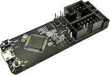
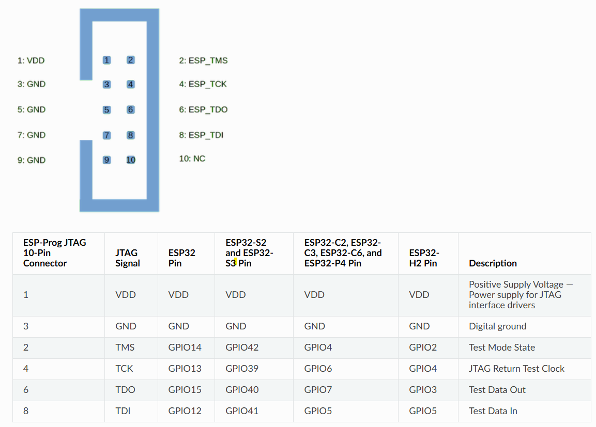

# ESP32 Debugging using ESP-Prog

To be able to debug programs on the ESP32, we need an ESP-Prog 
to control the ESP32's JTAG interface.

**JTAG (Joint Test Action Group)**: This is the industry-standard 
hardware interface used for verifying designs and debugging chips.

Unlike a serial (UART) connection that just sends text, 
**JTAG connects directly to the internal logic of the processor**. 

It allows a debugger to:

* Pause the CPU at any moment (halt).

* Step through code line by line.

* Inspect and modify registers and memory in real-time.

* Set breakpoints, which stop the program when a specific memory address is reached.

To use JTAG, we need a **bridge between our computer and the chip**: 

* Your Computer (GDB/IDE): Sends a command like "Stop at line 42."

* OpenOCD: Software on your PC that translates high-level commands 
    into JTAG bit-sequences.

* ESP-Prog: Converts USB signals into the physical 
    electrical pulses for the TMS/TCK/TDI/TDO pins.

* ESP32: Receives the signals and halts the CPU.


**ESP-Prog**: This is the specific hardware bridge provided by Espressif. 
It acts as a translator between your computer (via USB) and the ESP32’s 
JTAG pins.






## Built-in USB JTAG on the XIAO ESP32C3

The ESP32-C3 contains a **built-in USB Serial/JTAG controller**. On the
XIAO ESP32C3, the USB-C connector is wired directly to it, so we can
debug over the same USB cable that we use for upload and the serial
monitor. **No ESP-Prog is needed.**

In `platformio.ini`, we select the built-in adapter:

```ini
build_type = debug
debug_tool = esp-builtin
debug_init_break = tbreak setup
```

* `build_type = debug`: Build without optimizations and with debug
    symbols.

* `debug_tool = esp-builtin`: Use the chip's built-in USB JTAG instead
    of an external probe such as the ESP-Prog.

* `debug_init_break = tbreak setup`: Set a temporary breakpoint at
    `setup()` when the debug session starts.

Start a debug session from the project directory:

```bash
pio debug --interface=gdb -- -x .pioinit
```

Note that the ESP-Prog is still required for ESP32 chips without a
built-in USB JTAG controller (for example, the classic ESP32).

## References

* [ESP-Prog](https://docs.platformio.org/en/latest/plus/debug-tools/esp-prog.html)
* [ESP Built-in JTAG](https://docs.platformio.org/en/latest/plus/debug-tools/esp-builtin.html)

*Egon Teiniker, 2020-2026, GPL v3.0* 