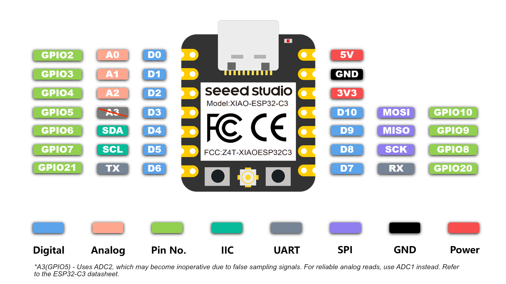

# XIAO ESP32-C3 


## Pinout 



### Power Pins

* **5V**: This is 5v out from the USB port. You can also use this as a voltage 
    input but you must have some sort of diode (schottky, signal, power) 
    between your external power source and this pin with anode to battery, cathode to 5V pin.
* **3V3**: This is the regulated output from the onboard regulator. 
    You can draw 700mA
* **GND**: Power/data/signal ground


### Digital IO 

Most pins labeled **D0 to D10** can be used as normal digital GPIO, but a few are 
*special* and are best avoided (or used with care) because they affect boot mode 
or have boot-time signals on them.

* **D0 / GPIO2** Strapping Pin:
    GPIO2 is sampled at reset to help decide the ESP32-C3 boot mode. 
    If your circuit forces it HIGH/LOW at the wrong moment, you can end up in a boot 
    mode where the board won’t run your app or won’t upload normally. 

    If you must use it: ensure external hardware does not drive it to the wrong level 
    during reset/boot (often: avoid strong pull-downs/outputs at boot).

* **D8 / GPIO8** Strapping Pin (extra sensitive on XIAO):
    GPIO8 is also a strapping pin. Seeed specifically warns that certain GPIO8/GPIO9 
    combinations at boot can cause unexpected behavior, and recommends adding a 
    pull-up if you use download/boot modes. 

    If you must use it: design so it’s HIGH at the required boot moments (typically via 
    a pull-up, depending on how you use BOOT/download).

* **D9 / GPIO9** Strapping Pin + BOOT Button Connected:
    D9 is tied to GPIO9 and also connected to the BOOT button (pressing BOOT pulls 
    it to GND). That makes it easy for your project wiring to accidentally interfere 
    with boot mode, and the button will also “fight” your circuit. 

    Best use case: Seeed suggests it’s better as a switch/button input (because it 
    already has that BOOT-button behavior). 

* **D6 Bootloader/UART0 TX Output at Startup**:
    On the XIAO ESP32C3, D6 is used as UART output at startup, including bootloader 
    messages and brief activity right after reset. If you use D6 as an input (or 
    connect it to something that can be driven), you can get unwanted currents or 
    weird behavior. Seeed explicitly recommends output-only and even “try not to use D6” 
    unless you understand the implications.

Practical rule of thumb:

* **Best default GPIO choices**: Use the non-strapping, non-boot-output pins **D1, D2, D3, 
    D4, D5, D7, D10** (everything except D0, D6, D8, D9).

* **If you need every pin**: you can still use strapping pins, but make sure external hardware 
    doesn’t force their level during reset/boot (use weak pulls, series resistors, avoid 
    hard-driven signals at boot).


## I2C 

The standard I2C pins are the ones silkscreened on the board:

* **D4 (GPIO6)**: SDA  

* **D5 (GPIO7)**: SCL 

ESP32 lets you route I2C to other GPIOs—but on this board it’s usually best to 
stick to D4/D5 unless you have a reason, and especially avoid strapping/boot-sensitive 
pins (like D8/D9) for I2C because they can interfere with boot modes.

_Example:_ Arduino using I2C - default settings

```C++
#include <Wire.h>

void setup() 
{
    Wire.begin();   // uses the board defaults
}
```

_Example:_ Arduino using I2C - explicit settings

```C++
#include <Wire.h>

void setup() 
{
    Wire.begin(D4, D5); // SDA, SCL
}
```

## UART

The default UART pins are:

* **D6 (GPIO21)**: TX	
* **D7 (GPIO20)**: RX	

These pins are used for flashing, boot messages, and Serial and safe 
for UART, but not ideal for general-purpose I/O.


_Example:_ Arduino using default Serial

```C++
void setup() 
{
    Serial.begin(115200);
}
```

_Example:_ Arduino using custom UART

The ESP32-C3 allows UART remapping, so you can create another serial 
port on almost any safe GPIO.

```C++
HardwareSerial Serial1(1);

void setup() 
{
    Serial1.begin(9600, SERIAL_8N1, D4, D5); // RX, TX
}
```

Good pin choices for custom UART: 

* Use non-strapping, non-boot pins, such as: D1, D2, D3, D4, D5

* These are ideal for: GPS modules, RS-485, Bluetooth modules, External MCUs, 
    Sensors with UART


## References 

* [Getting Started with Seeed Studio XIAO ESP32C3](https://wiki.seeedstudio.com/XIAO_ESP32C3_Getting_Started/)

*Egon Teiniker, 2020-2026, GPL v3.0* 