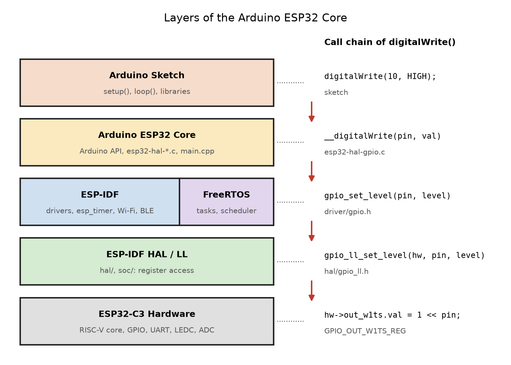
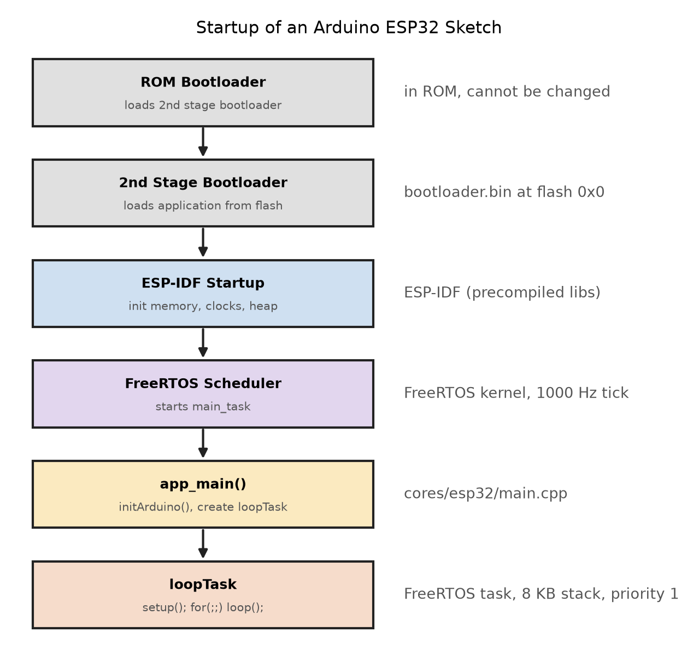

# ESP32 Arduino Core

There is a dedicated implementation of the Arduino Core Framework for
the ESP32 family, developed by Espressif:
[arduino-esp32](https://github.com/espressif/arduino-esp32).
It supports the ESP32, ESP32-S2, ESP32-S3, ESP32-C3, ESP32-C6 and other
chips of the family.

In contrast to the AVR core, which accesses the registers of the
ATmega328P directly, the ESP32 core is **not written from scratch**. It
is a thin Arduino layer on top of Espressif's own development framework
**ESP-IDF**, which already includes the real-time operating system
**FreeRTOS**.

## Layered Architecture



From top to bottom, a sketch for the ESP32 uses the following layers:

* **Arduino Sketch**\
    Our application code with `setup()` and `loop()`, and Arduino
    libraries (e.g. `Wire`, `SPI`, `WiFi`).

* **Arduino ESP32 Core** (`cores/esp32/`)\
    Implements the Arduino API (`pinMode()`, `digitalWrite()`, `Serial`,
    `millis()`, ...) by mapping each function to ESP-IDF calls. The
    adaptation code is located in files named `esp32-hal-*.c`, e.g.
    `esp32-hal-gpio.c`, `esp32-hal-uart.c` or `esp32-hal-ledc.c`.

* **ESP-IDF** (Espressif IoT Development Framework)\
    The official SDK of Espressif. It provides **drivers** for all
    peripherals (`driver/gpio.h`, `driver/uart.h`, ...), **system
    services** (`esp_timer`, logging, watchdogs, non volatile storage)
    and the **network stacks** (Wi-Fi, Bluetooth LE, TCP/IP).
    ESP-IDF is integrated as a set of **precompiled libraries**
    (`framework-arduinoespressif32-libs`), therefore its configuration
    (`sdkconfig`) cannot be changed from a normal Arduino project.

* **FreeRTOS**\
    Part of ESP-IDF. A preemptive real-time kernel which provides
    **tasks**, a scheduler, queues, semaphores and timers. On the ESP32
    there is no "bare metal" Arduino sketch: `loop()` always runs inside
    a FreeRTOS task.

* **ESP-IDF HAL / LL** (`hal/`, `soc/`)\
    The lowest software layer of ESP-IDF. The **LL** (low level)
    functions are small `static inline` functions which read and write
    the peripheral registers. They are different for each chip
    (`hal/esp32c3/include/hal/gpio_ll.h`).

* **Hardware**\
    The ESP32-C3 SoC with a 32-bit RISC-V core (160 MHz), 400 KB SRAM,
    and peripherals like GPIO, UART, I2C, SPI, LEDC (PWM) and ADC.


### Following a Function Call

We can follow a call of `digitalWrite()` through all layers.

_Example_: Arduino Core (`cores/esp32/esp32-hal-gpio.c`)

```C++
extern void ARDUINO_ISR_ATTR __digitalWrite(uint8_t pin, uint8_t val) {
  // ...
  if (perimanGetPinBus(pin, ESP32_BUS_TYPE_GPIO) != NULL) {
    gpio_set_level((gpio_num_t)pin, val);
  } else {
    log_e("IO %u is not set as GPIO. Execute digitalMode(%u, OUTPUT) first.",
        pin, pin);
  }
}
```

`digitalWrite()` is defined as an alias of `__digitalWrite()`. The
**peripheral manager** (`perimanGetPinBus()`) knows which peripheral uses
a pin. If the pin was not configured with `pinMode()`, an error is
logged and nothing happens. Otherwise, the ESP-IDF driver function
`gpio_set_level()` is called.

_Example_: ESP-IDF LL function (`hal/esp32c3/include/hal/gpio_ll.h`)

```C++
static inline void gpio_ll_set_level(gpio_dev_t *hw, uint32_t gpio_num,
                                     uint32_t level)
{
    if (level) {
        hw->out_w1ts.val = 1 << gpio_num;
    } else {
        hw->out_w1tc.val = 1 << gpio_num;
    }
}
```

Via `gpio_hal_set_level()`, the driver finally reaches this LL function.
It writes to one of two registers:

* `GPIO_OUT_W1TS_REG` (**write 1 to set**): every 1 bit sets the
    corresponding output to `HIGH`.
* `GPIO_OUT_W1TC_REG` (**write 1 to clear**): every 1 bit sets the
    corresponding output to `LOW`.

Because only the bits written as 1 are affected, there is no
read-modify-write sequence. Unlike the AVR core, interrupts do not need
to be disabled during the write.


## Startup and the Sketch Programming Model



On the AVR, the Arduino core implements `main()` directly. On the ESP32,
several steps happen before our sketch starts:

1. The **ROM bootloader** (stored in the chip) loads the second stage
    bootloader from flash.
2. The **second stage bootloader** (`bootloader.bin`) reads the
    partition table and loads the application.
3. The **ESP-IDF startup code** initializes memory, clocks and heap and
    starts the **FreeRTOS scheduler**.
4. The FreeRTOS `main_task` calls the function `app_main()`, which is
    the entry point of every ESP-IDF application.

The Arduino core implements `app_main()` in `cores/esp32/main.cpp`:

```C++
extern "C" void app_main() {
  // ...
  initArduino();
  xTaskCreateUniversal(loopTask, "loopTask",
      getArduinoLoopTaskStackSize(), NULL, 1,
      &loopTaskHandle, ARDUINO_RUNNING_CORE);
}
```

`app_main()` initializes the Arduino core and creates a new FreeRTOS
task named `loopTask`. This task calls our sketch functions:

```C++
void loopTask(void *pvParameters) {
  // ...
  setup();
  // ...
  for (;;) {
#if CONFIG_FREERTOS_UNICORE
    yieldIfNecessary();
#endif
    if (loopTaskWDTEnabled) {
      esp_task_wdt_reset();
    }
    loop();
    if (serialEventRun) {
      serialEventRun();
    }
  }
}
```

The well known programming model (`setup()` once, `loop()` forever) is
the same as on the AVR, but there are important differences:

* `loop()` runs in a **FreeRTOS task** with priority 1 and a stack of
    **8 KB** (`CONFIG_ARDUINO_LOOP_STACK_SIZE`). Large local arrays can
    cause a stack overflow.

* `delay()` is implemented with `vTaskDelay()`. The `loopTask` is
    blocked and the scheduler can run **other tasks** in the meantime
    (e.g. the Wi-Fi stack).

* The ESP32-C3 has only one core (`CONFIG_FREERTOS_UNICORE`). If
    `loop()` never calls `delay()`, `yieldIfNecessary()` gives other tasks
    a chance to run every 2 seconds.

* A **task watchdog** monitors the system. A task that blocks the CPU
    for too long (5 seconds by default) triggers a watchdog error.


## Arduino API on AVR and ESP32

The same Arduino function can be implemented in a completely different
way, depending on the hardware:

| Function         | AVR Core (Uno)           | ESP32 Core (XIAO ESP32C3)    |
|:--               |:--                       |:--                           |
| `main()`         | in the core (`main.cpp`) | `app_main()` + `loopTask`    |
| `digitalWrite()` | `PORTx` register         | `gpio_set_level()` (ESP-IDF) |
| `millis()`       | Timer0 overflow ISR      | `esp_timer_get_time()`       |
| `micros()`       | Timer0, 4 us resolution  | `esp_timer`, 1 us resolution |
| `delay()`        | busy waiting             | `vTaskDelay()` (FreeRTOS)    |
| `analogWrite()`  | Timer PWM, 490/976 Hz    | LEDC, 1000 Hz, 8 bit         |
| `analogRead()`   | 10 bit (0 to 1023)       | 12 bit (0 to 4095)           |
| Pin numbers      | Arduino pin numbers      | GPIO numbers (`D0` = GPIO2)  |
| Data types       | `int` = 16 bit           | `int` = 32 bit               |

ESP32 specific functions extend the API, e.g.
`analogWriteFrequency()`, `analogWriteResolution()`,
`analogReadMilliVolts()` and `Serial.printf()`.


### Pin Numbers

On the ESP32, a pin number in the Arduino API is the **GPIO number** of
the chip. The board specific names are defined in the variant file
(`variants/XIAO_ESP32C3/pins_arduino.h`):

```C++
static const uint8_t D0 = 2;
static const uint8_t D1 = 3;
static const uint8_t D2 = 4;
static const uint8_t D3 = 5;
static const uint8_t D4 = 6;    // SDA
static const uint8_t D5 = 7;    // SCL
static const uint8_t D6 = 21;   // TX
static const uint8_t D7 = 20;   // RX
static const uint8_t D8 = 8;    // SCK
static const uint8_t D9 = 9;    // MISO
static const uint8_t D10 = 10;  // MOSI
```

Use the board names (`D0` to `D10`, `A0` to `A2`) to keep the code
readable and independent from the GPIO numbering of the chip.


## Using ESP-IDF and FreeRTOS from a Sketch

Since ESP-IDF and FreeRTOS are always part of the firmware, a sketch can
use all three layers at the same time. This is useful when the Arduino
API does not cover a feature, but it makes the code **dependent on the
ESP32**.

_Example_: Arduino API, FreeRTOS task and ESP-IDF driver in one sketch

```C++
#include <Arduino.h>
#include "driver/gpio.h"            // ESP-IDF GPIO driver

const uint8_t PIN_LED = D10;        // GPIO10 on the XIAO ESP32C3

void blink_task(void *parameter)    // FreeRTOS task
{
    for(;;)
    {
        gpio_set_level((gpio_num_t)PIN_LED, 1);     // ESP-IDF
        vTaskDelay(pdMS_TO_TICKS(500));             // FreeRTOS
        gpio_set_level((gpio_num_t)PIN_LED, 0);
        vTaskDelay(pdMS_TO_TICKS(500));
    }
}

void setup()
{
    Serial.begin(115200);
    pinMode(PIN_LED, OUTPUT);                       // Arduino
    xTaskCreate(blink_task, "blink", 2048, NULL, 1, NULL);
}

void loop()
{
    Serial.printf("loop() runs in task: %s, uptime: %lu ms\n",
        pcTaskGetName(NULL), millis());
    delay(1000);
}
```

* The external LED on `D10` blinks in its own FreeRTOS task
    (`blink_task`), independent of `loop()`.

* `pcTaskGetName(NULL)` returns the name of the current task, which is
    `loopTask`.

* The FreeRTOS headers are already included by `Arduino.h`, only the
    ESP-IDF driver header must be added.

The XIAO ESP32C3 has no user LED, so an external LED with a resistor
must be connected to `D10`.


## ESP32 Core Extensions

Additionally, the ESP32 implementation offers the following features:

* [Serial.printf()](Serial.md)
* [String](String.md)
* [F() String](F-String.md)


## References

* [GitHub: ESP32 Arduino Core](https://github.com/espressif/arduino-esp32)

* [Arduino ESP32 Documentation][arduino-esp32-doc]

* [ESP-IDF Programming Guide: ESP32-C3][idf]

* [ESP-IDF: Application Startup Flow][startup]

[arduino-esp32-doc]:
    https://docs.espressif.com/projects/arduino-esp32/en/latest/
[idf]: https://docs.espressif.com/projects/esp-idf/en/latest/esp32c3/
[startup]:
    https://docs.espressif.com/projects/esp-idf/en/latest/esp32c3/api-guides/startup.html

*Egon Teiniker, 2020-2026, GPL v3.0*
