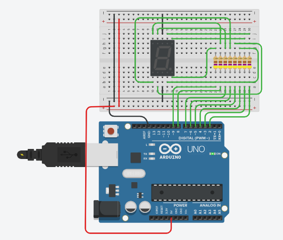

# Serial vs. 7-Segment

This example implements a small API function `print_hex()` that shows a
hexadecimal digit (0 to F). The **same source code** can output the digit
in two different ways:

* On a **7-segment display** connected to the digital pins 2 to 9, or

* As text on the **serial monitor** (UART, 9600 baud).

Which variant ends up in the firmware is decided at compile time by the
**C preprocessor** using **conditional compilation**. The application code
in `loop()` only calls `print_hex()` and does not know which output device
is used.


## Wiring Diagram



The 7-segment display has a common cathode connected to GND. Each segment
(A to G and the decimal point DP) is connected via a resistor to one digital
pin. A segment is switched on when its pin is set to `HIGH`.

| Segment | A | B | C | D | E | F | G | DP |
|:--      |:--|:--|:--|:--|:--|:--|:--|:-- |
| Pin     | 2 | 3 | 4 | 5 | 6 | 7 | 8 | 9  |


## Source Code

```C++
const int PIN_A = 2;
const int PIN_B = 3;
const int PIN_C = 4;
const int PIN_D = 5;
const int PIN_E = 6;
const int PIN_F = 7;
const int PIN_G = 8;
const int PIN_DP = 9;

//#define DISPLAY_7_SEGMENT
#define DISPLAY_SERIAL

void setup()
{
#ifdef DISPLAY_7_SEGMENT
    pinMode(PIN_A, OUTPUT);
    pinMode(PIN_B, OUTPUT);
    pinMode(PIN_C, OUTPUT);
    pinMode(PIN_D, OUTPUT);
    pinMode(PIN_E, OUTPUT);
    pinMode(PIN_F, OUTPUT);
    pinMode(PIN_G, OUTPUT);
    pinMode(PIN_DP, OUTPUT);
#endif
#ifdef DISPLAY_SERIAL
    Serial.begin(9600);
#endif
}

void set_segments(uint8_t s)
{
    digitalWrite(PIN_A, (s >> 7 & 1) ? HIGH : LOW);
    digitalWrite(PIN_B, (s >> 6 & 1) ? HIGH : LOW);
    digitalWrite(PIN_C, (s >> 5 & 1) ? HIGH : LOW);
    digitalWrite(PIN_D, (s >> 4 & 1) ? HIGH : LOW);
    digitalWrite(PIN_E, (s >> 3 & 1) ? HIGH : LOW);
    digitalWrite(PIN_F, (s >> 2 & 1) ? HIGH : LOW);
    digitalWrite(PIN_G, (s >> 1 & 1) ? HIGH : LOW);
    digitalWrite(PIN_DP, (s & 1) ? HIGH : LOW);
}

uint8_t hex_segments[16] =
{   //ABCDEFG.
    0b11111100, // 0
    0b01100000, // 1
    0b11011010, // 2
    0b11110010, // 3

    0b01100110, // 4
    0b10110110, // 5
    0b10111110, // 6
    0b11100000, // 7

    0b11111110, // 8
    0b11110110, // 9
    0b11101110, // A
    0b00111110, // B
    //ABCDEFG.
    0b10011100, // C
    0b01111010, // D
    0b10011110, // E
    0b10001110  // F
};

void print_hex(uint8_t number) // public API
{
    if(number > 15)
    {
        set_segments(0x00);
    }
    else
    {
#ifdef DISPLAY_7_SEGMENT
        set_segments(hex_segments[number]);
#endif
#ifdef DISPLAY_SERIAL
        Serial.print(number, HEX);
#endif
    }
}

void loop()
{
    for(int i=0; i<16; i++)
    {
        print_hex(i);   // Call API
        delay(1000);
    }
}
```

The program consists of three parts:

* **Hardware specific code**: `set_segments()` writes one byte to the eight
    segment pins. Bit 7 controls segment A, bit 0 controls the decimal
    point. The table `hex_segments[]` stores the segment pattern for each
    hexadecimal digit (e.g. `0b01100000` switches on B and C, which shows
    a `1`).

* **API function**: `print_hex()` hides the output device from the caller.
    Inside this function, the preprocessor selects the device specific
    code.

* **Application code**: `loop()` counts from 0 to 15 and calls
    `print_hex()` once per second.


## Conditional Compilation

Before the compiler sees the source code, the **C preprocessor** processes
all lines starting with `#`. It works purely on text: it replaces macros,
includes header files and removes code blocks whose condition is false.

The directives used in this example are:

* `#define DISPLAY_SERIAL` defines a macro without a value. The macro only
    acts as a **flag**: it is either defined or not.

* `#ifdef NAME` ... `#endif` keeps the lines in between only if the macro
    `NAME` is defined. Otherwise these lines are removed completely.

To switch between the two output devices, we only change which macro is
defined:

```C++
//#define DISPLAY_7_SEGMENT     // 7-segment display disabled
#define DISPLAY_SERIAL          // serial output enabled
```

### Preprocessor Output

We can make the result of the preprocessor visible by calling the compiler
with the option `-E` (stop after preprocessing). The following output was
generated with `avr-g++ -E -P` for the function `print_hex()`.

_Example_: `DISPLAY_SERIAL` is defined

```C++
void print_hex(uint8_t number)
{
    if(number > 15)
    {
        set_segments(0x00);
    }
    else
    {
        Serial.print(number, HEX);
    }
}
```

_Example_: `DISPLAY_7_SEGMENT` is defined

```C++
void print_hex(uint8_t number)
{
    if(number > 15)
    {
        set_segments(0x00);
    }
    else
    {
        set_segments(hex_segments[number]);
    }
}
```

The compiler only gets the remaining lines. Code of the other variant is
**not part of the firmware**, there is no runtime check (`if`) that decides
between serial and 7-segment output.


### Effect on the Firmware Size

Because unused code is removed before compilation, each variant only
contains what it really needs. The following numbers were measured with
PlatformIO (Arduino Uno, `pio run`):

| Variant                          | Flash        | RAM        |
|:--                               |--:           |--:         |
| `DISPLAY_7_SEGMENT`              | 1152 bytes   | 25 bytes   |
| `DISPLAY_SERIAL`                 | 1902 bytes   | 184 bytes  |
| both macros defined              | 2212 bytes   | 200 bytes  |

* The serial variant needs much more RAM, because `HardwareSerial` uses
    a receive and a transmit buffer (64 bytes each on the Uno).

* In the serial variant, the table `hex_segments[]` is not referenced by
    any code, so the linker removes it (16 bytes less RAM).

* If both macros are defined, the digit is shown on the display **and**
    sent to the serial monitor.

On a small microcontroller like the ATmega328P (32 KB Flash, 2 KB RAM),
this is the main advantage of conditional compilation over a runtime
decision.


### Exactly One Variant

In the code above, nothing prevents us from defining both macros or
forgetting both. If no macro is defined, the program compiles without
warning but shows nothing at all.

With `#if defined`, `#elif` and `#error`, we can make sure that exactly
one variant is selected:

```C++
#if defined(DISPLAY_7_SEGMENT) && defined(DISPLAY_SERIAL)
    #error "Define only one of DISPLAY_7_SEGMENT or DISPLAY_SERIAL"
#elif !defined(DISPLAY_7_SEGMENT) && !defined(DISPLAY_SERIAL)
    #error "Define DISPLAY_7_SEGMENT or DISPLAY_SERIAL"
#endif
```

Now an invalid configuration is detected **at compile time** and not
on the running device.


## Simulation

_Example_: [Tinkercad: 7-Segment Output][tinkercad]

[tinkercad]:
    https://www.tinkercad.com/things/fBEtVlXAG2W-arduino-7-segment-hardware-abstraction


## References

* K. N. King. **C Programming, A Modern Approach.** W. W. Norton &
    Company, inc. 2nd Edition 2008.
    * Chapter 14: The Preprocessor

* GCC: 
    [The C Preprocessor, Conditionals](https://gcc.gnu.org/onlinedocs/cpp/Conditionals.html)

*Egon Teiniker, 2020-2026, GPL v3.0*
